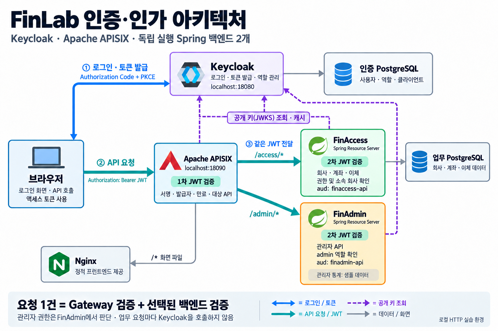

# FinAdmin · Keycloak과 APISIX 인증·인가 실습

[FinAccess](https://github.com/Greenapple0101/finaccess)와 별도로 실행하는 Spring Boot 관리자 API입니다. 이 저장소에는 두 백엔드를 함께 실습하기 위한 **Keycloak, Apache APISIX, 로그인 화면, 실행·검증 스크립트**도 있습니다.

Keycloak에서 발급받은 액세스 토큰을 APISIX가 검사하고 전달합니다. FinAccess와 FinAdmin도 각각 토큰을 다시 검증하고, 자기 앱의 역할과 업무 규칙에 따라 응답합니다.



[아키텍처 그림을 읽는 순서](docs/10-architecture.md) · [PNG 원본](docs/images/finlab-architecture.png)

```text
브라우저 ── 로그인(Code + PKCE) ── Keycloak
브라우저 ── Bearer 액세스 토큰 ── APISIX
                                  ├── FinAccess: JWT + 역할 + 회사·이체 규칙
                                  └── FinAdmin: JWT + 관리자 역할
```

**실습 화면: [http://localhost:18090/](http://localhost:18090/)** · **Keycloak 관리: [http://localhost:18080/admin/](http://localhost:18080/admin/)**

## 현재 구현한 내용

- Java 21 · Spring Boot 4.1.1 · Gradle Wrapper 9.7.1
- Keycloak 26.7.4 · Apache APISIX 3.18.0 · PostgreSQL 17.11
- 프런트의 Authorization Code + PKCE 로그인과 Bearer API 호출
- APISIX의 JWT 검증과 목적지 API별 audience 검사, Authorization 헤더 전달
- 두 Spring Resource Server의 독립적인 JWT 서명·발급자·시간·대상 검증
- FinAdmin의 Client 역할에 따른 관리자 API 제한
- FinAccess의 토큰 신원 연결, 회사 접근 제한, 요청·승인·반려·모의 이체 처리

FinAdmin API의 직접 호출 규칙은 다음과 같습니다.

| API | 접근 조건 | 반환 내용 |
| --- | --- | --- |
| `GET /api/hello` | 토큰 없이 가능 | FinAdmin 인사말 |
| `GET /api/me` | 유효한 FinAdmin 대상 토큰 | 앱 이름, subject, issuer, 이 앱의 역할 |
| `GET /api/admin/summary` | 유효한 토큰 + `finadmin-api`의 `admin` 역할 | 관리자용 샘플 요약 |

Gateway는 `/admin/*`, `/access/*` 전체에 토큰 검증을 적용하므로 Gateway를 거친 인사 API도 토큰이 필요합니다. 관리자 요약의 숫자 3과 7은 고정 예시이고 `sampleData: true`로 표시합니다. 실제 FinAccess 통계가 아닙니다.

## 실행하기

Java 21, Python 3, 실행 중인 Docker와 Docker Compose가 필요합니다. 처음에는 Gradle 의존성과 컨테이너 이미지를 내려받습니다. 두 저장소를 같은 부모 폴더 아래에 둡니다.

```text
같은 부모 폴더/
├── finaccess/
└── finadmin/
```

아직 저장소가 없다면 새 부모 폴더에서 각각 복제합니다. 이미 있다면 다시 복제하지 않아도 됩니다.

```bash
git clone https://github.com/Greenapple0101/finaccess.git
git clone https://github.com/Greenapple0101/finadmin.git
cd finadmin
./scripts/start.sh
```

`start.sh`는 아래 작업을 순서대로 합니다.

1. 무작위 실습 비밀번호를 `.env`와 데스크탑의 로컬 인증 문서에 준비합니다.
2. 옆 폴더의 FinAccess와 현재 FinAdmin을 각각 실행 JAR로 빌드합니다.
3. `finlab` Compose 프로젝트의 컨테이너들을 실행합니다.
4. Keycloak에서 실제 로그인하고 API와 모의 이체를 자동 검증합니다.

이 스크립트의 빌드 단계는 `bootJar`입니다. 전체 Java 테스트는 아래의 별도 명령으로 실행합니다. 자동 검증에는 실제 토큰의 만료와 Spring 시간 오차 허용 범위를 기다리는 과정이 있어 서버 준비 후에도 1분 이상 걸릴 수 있습니다.

| 접속 대상 | 주소 | 용도 |
| --- | --- | --- |
| 앱 화면·APISIX | [localhost:18090](http://localhost:18090/) | 로그인과 Gateway를 통한 API 호출 |
| Keycloak | [localhost:18080/admin/](http://localhost:18080/admin/) | Realm·Client·사용자·역할 확인 |
| FinAccess 직접 호출 | `http://localhost:18082` | 백엔드의 독립적인 검증 확인 |
| FinAdmin 직접 호출 | `http://localhost:18083` | 백엔드의 독립적인 검증 확인 |

공개 포트는 모두 내 컴퓨터의 `127.0.0.1`에만 연결합니다. DB는 호스트 포트를 열지 않습니다. 기존 FinAccess 개발 DB와 별개인 `finlab` 전용 DB와 볼륨을 사용합니다.

## 화면에서 보는 순서

1. 앱 화면에서 `alice`로 로그인합니다.
2. **FinAdmin 내 정보**를 누르면 200, **관리자 요약**을 누르면 403인지 확인합니다.
3. **FinAccess 내 정보**의 `sub`와 **FinAdmin 내 정보**의 `subject`, 두 응답의 `issuer`가 같은지 비교합니다.
4. 로그아웃하고 `admin`으로 로그인하면 관리자 요약이 200으로 바뀌는지 확인합니다.
5. **토큰 없이 관리자 요약 요청**으로 401을 확인합니다.

비밀번호는 데스크탑의 `finadmin-local-secrets.md`에 있습니다. `admin`은 앱 관리자이고, `bootstrap-admin`은 Keycloak 관리 콘솔 전용 계정입니다.

## 비밀번호·토큰·검증 데이터 위치

| 파일 | 내용 | Git에 포함 |
| --- | --- | --- |
| `.env.example` | 필요한 환경 변수 이름만 제공 | 포함 |
| `.env` | 로컬 실행에 쓰는 실제 비밀번호 | 제외 |
| 데스크탑 `finadmin-local-secrets.md` | 실제 계정 비밀번호·검증용 액세스 토큰·만료 시각 | 저장소 밖 |
| `.local/verification.json` | 토큰 없는 검증 상태 코드·잔액 결과 | 제외 |

비밀값 파일은 소유자만 읽고 쓰도록 만들지만 평문입니다. 공개 MD 문서에는 실제 비밀번호와 토큰을 넣지 않습니다. 기존 `.env` 비밀번호는 초기화 스크립트가 보존하며, `.env` 값을 바꿔도 이미 생성한 Keycloak 계정의 비밀번호가 자동으로 변경되지는 않습니다.

전체 검증을 다시 실행하려면 다음 명령을 사용합니다.

```bash
python3 scripts/verify.py
```

이 명령은 읽기만 하는 상태 확인이 아닙니다. 저장소가 관리하는 `finlab-*` 공개 Client와 필요한 기본 Client Scope 연결을 맞추고, 전용 실습 DB에 회사·사용자 연결을 준비한 뒤 새 계좌와 모의 이체 데이터를 추가합니다. 기존 데이터를 삭제하지 않습니다. 사용자 로그인은 Code + PKCE이며, 설정 동기화에만 관리용 `admin-cli` 토큰을 일시 사용합니다. 세부 동작은 [전체 검증 설명](docs/08-end-to-end-verification.md)에 있습니다.

## 테스트와 확인한 결과

2026-09-29 기준:

| 검증 | 결과 |
| --- | --- |
| FinAdmin Java 테스트 | 19개 통과 |
| FinAccess Java 테스트 | 149개 통과 |
| 실제 Keycloak·APISIX·두 백엔드 HTTP 검증 | 46개 통과 |
| 모의 이체 후 실제 DB 잔액 | 출금 10,000 → 9,000원, 입금 0 → 1,000원 |

FinAdmin 테스트는 임시 JWKS 서버와 실제 RSA 서명 토큰으로 JWT 검증 실패도 확인합니다. 전체 HTTP 검증은 실행 중인 Keycloak이 발급한 토큰을 사용합니다. 실제 만료 토큰과 미래 `nbf` 토큰, 다른 API 대상 토큰, 역할 부족, 회사 불일치, 사용자 ID 위조, 자기 승인, 중복 실행까지 구분해 확인합니다.

```bash
# finadmin 폴더에서
./gradlew test bootJar

# finaccess 폴더에서
./gradlew test bootJar
```

FinAccess의 DB 통합 테스트는 Docker를 사용합니다. 검증 범위와 401·403의 차이는 [08번 문서](docs/08-end-to-end-verification.md)에 정리했습니다.

## 중지와 재시작

```bash
docker compose stop
docker compose up -d
```

일반 중지는 `stop`으로 충분합니다. `down`은 컨테이너와 네트워크를 제거하며, **`down -v`는 DB 볼륨까지 삭제**하므로 일상적인 종료에 사용하지 않습니다. 코드 변경 후에는 `./scripts/start.sh`로 빌드·이미지 생성·검증을 다시 진행합니다.

FinAdmin만 Java로 읽어 보려면 `./gradlew bootRun`도 가능합니다. 이때 기본 직접 주소는 `http://127.0.0.1:8081`이고 Docker의 18083과 다릅니다. 토큰 없는 `/api/hello`는 실행할 수 있으며, 보호된 API에는 Keycloak에서 발급한 유효한 토큰이 필요합니다.

## 문서 읽는 순서

주석과 문서는 파일의 역할 → 요청이 흐르는 순서 → 설정과 문법의 의미를 쉬운 말로 설명합니다.

**Keycloak 콘솔을 열어 놓고 공부할 때는 [핸즈온 보고서](docs/11-keycloak-hands-on-report.md)부터 읽습니다.** 메뉴 위치 → 현재 값 → 설정 이유 → JWT 변화 → API 응답까지 연결합니다. [설정값 목록](docs/12-keycloak-settings-reference.md)에는 실제 서버에서 조회한 값과 보고서 작성 중 새로 통과한 읽기 전용 API 확인 32건을 모았습니다.

1. [처음 FinAdmin 앱을 만든 순서](docs/01-first-application.md) — **인증을 넣기 전의 과거 단계**입니다. 현재 접근 규칙은 05·06번을 기준으로 읽습니다.
2. [Keycloak 실행 환경](docs/02-keycloak-setup.md)
3. [Realm·Client·사용자·역할](docs/03-keycloak-realm-client-role.md)
4. [로그인과 액세스 토큰](docs/04-access-token.md)
5. [Spring의 JWT 검증](docs/05-jwt-validation.md)
6. [관리자 권한 제한](docs/06-admin-authorization.md)
7. [APISIX Gateway의 검증과 전달](docs/07-apisix-gateway.md)
8. [전체 흐름의 검증 결과와 재현 방법](docs/08-end-to-end-verification.md)
9. [회사 내부 공유 문서](docs/09-internal-sharing.md)
10. [아키텍처 그림을 읽는 순서](docs/10-architecture.md)
11. [Keycloak 설정을 직접 따라 읽는 핸즈온 보고서](docs/11-keycloak-hands-on-report.md)
12. [Keycloak 현재 설정값 목록과 확인 기록](docs/12-keycloak-settings-reference.md)

## 실습 범위

실제 인증·인가 흐름을 실행하는 로컬 학습 환경입니다. Keycloak은 HTTP와 `start-dev`로 실행하고, 백엔드 직접 호출 포트는 독립적인 검증을 확인하기 위해 로컬에 열었습니다. 운영 HTTPS·네트워크 격리·비밀값 관리·모니터링·백업·가용성 구성은 별도 작업입니다.

관리자 통계는 샘플이고 사용자 가입·프로비저닝 API는 없습니다. 공개 키로 검증하는 기존 JWT에 역할 변경이나 로그아웃이 즉시 반영된다고 보장하지 않습니다. 여러 프런트 사이의 SSO 시연, Istio, 대규모 부하 시험, 고가용성 검증은 포함하지 않았습니다.
