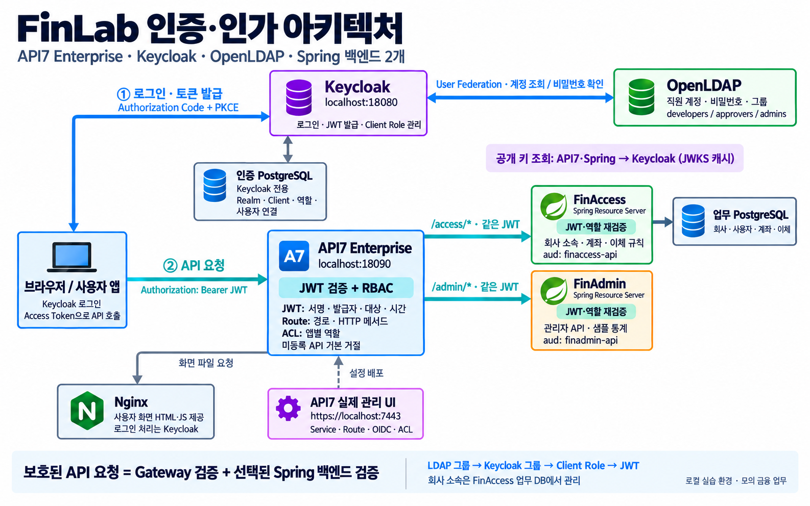

# FinLab 인증·인가 아키텍처

2026-10-06 현재 코드·설정 기준입니다. Gateway는 API7 Enterprise이며, 업무 백엔드는 FinAccess와 FinAdmin 두 개입니다.

## 1. 먼저 로그인해서 토큰을 받습니다

브라우저의 사용자 앱이 Keycloak으로 이동하고 Authorization Code + PKCE로 Access Token을 받습니다. Keycloak은 내부 사용자 또는 User Federation으로 연결한 OpenLDAP 직원을 인증합니다. OpenLDAP은 직원 비밀번호와 그룹의 원본이며 JWT를 발급하지 않습니다.

LDAP 그룹은 Keycloak 그룹과 Client Role로 연결되어 새 토큰에 반영됩니다. 회사 소속은 별도로 FinAccess 업무 DB의 `iss + sub` 연결에서 판단합니다. 그룹을 제거해도 이미 발급된 JWT가 즉시 바뀌지는 않습니다.

## 2. API7과 목적지 백엔드가 차례로 검사합니다

브라우저가 `Authorization: Bearer <Access Token>`을 보냅니다. API7은 서명·발급자·대상·시간을 검사하고, Route의 경로·HTTP 메서드와 기본 ACL의 앱별 역할로 접근을 제한합니다. 짧은 보조 함수는 시간·신원·역할 자료형 검사를 보완합니다.

| 외부 경로 | 내부 대상 | 뒤에서 추가로 검사하는 것 |
|---|---|---|
| `/access/*` | FinAccess `finaccess:8080` | `finaccess-api` 역할, 회사 소속, 이체 규칙 |
| `/admin/*` | FinAdmin `finadmin:8081` | `finadmin-api` 역할, 관리자 접근 |

API7은 접두사 `/access` 또는 `/admin`을 제거하고 같은 Bearer JWT를 전달합니다. 각 Spring 앱도 서명·발급자·대상·시간과 역할을 독립적으로 검사합니다. **보호된 API 요청 한 건은 Gateway와 선택된 백엔드의 검사를 거칩니다.** 두 백엔드를 차례로 모두 통과하는 구조는 아닙니다.

예외로 백엔드 직접 `GET /api/hello`는 공개 진단용입니다. Gateway를 거치는 hello에는 토큰과 앱 역할이 필요합니다. 앱 화면 파일도 로그인 전에 받아야 하므로 공개합니다. [API별 정책표](14-gateway-rbac-policy.md)에 예외와 역할을 함께 적었습니다.

## 3. 공개 키 조회와 업무 요청은 구분합니다

API7과 두 Spring 앱은 Keycloak의 JWKS에서 공개 키를 조회·캐시합니다. 그림의 보라색 문장은 **조회하는 쪽이 API7·Spring, 조회 대상이 Keycloak**임을 나타냅니다. API 요청마다 LDAP에서 비밀번호를 확인하거나 Keycloak에 로그인하는 방식이 아닙니다.

## 4. 사용자 화면과 관리 화면은 다릅니다

| 주소·구성 | 맡은 일 |
|---|---|
| `http://localhost:18090` | API7 경유 사용자 앱과 API 호출 |
| Nginx `web:80` | HTML·JS·CSS 파일 제공. 인증 판단이나 Gateway 설정 관리를 하지 않음 |
| `https://localhost:7443` | 실제 API7 Enterprise 관리 UI. Control Plane을 통한 Service·Route·플러그인 설정 배포 |
| `http://localhost:18080` | Keycloak 사용자 로그인과 Realm 관리 |
| `http://localhost:18082`, `18083` | 각각 FinAccess·FinAdmin 직접 검증용 로컬 포트 |

관리 UI에서 Gateway로 향하는 점선은 설정 배포를 요약합니다. 관리 UI 운영자 계정과 Keycloak 업무 사용자의 역할은 별개입니다. UI가 업무 요청을 대신 처리하지 않습니다.

## 5. 저장소 두 개도 역할이 다릅니다

Keycloak 전용 PostgreSQL에는 Realm·Client·역할·사용자 연결 정보 등을 저장합니다. FinAccess 업무 PostgreSQL에는 회사·업무 사용자·계좌·이체를 저장합니다. LDAP 비밀번호를 Keycloak DB로 복사하는 구성은 아닙니다. FinAdmin 요약은 샘플 데이터이며 별도 통계 DB를 사용하지 않습니다.

원본 설정: [앱 Compose](../compose.yaml), [API7 Compose](../compose.api7.yaml), [Route·ACL 정책](../infra/gateway/policies.json), [Keycloak Realm](../infra/keycloak/finlab-realm.json), [LDAP 연결](../infra/keycloak/ldap-federation.json). 실제 결과와 운영 과제는 [연동·검증 보고서](15-api7-enterprise-integration.md)를 참고하세요.
