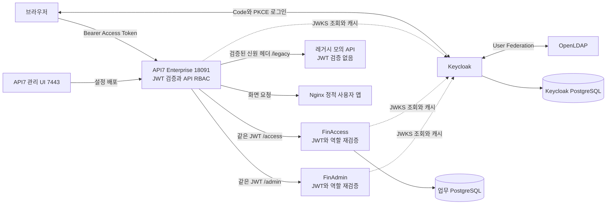
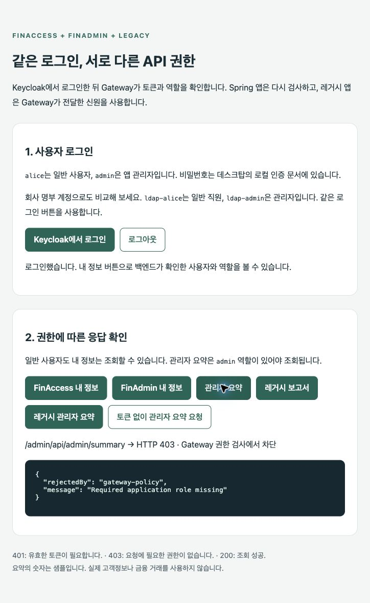

# API7 Enterprise 연동과 검증 보고서

2026-10-06. FinLab의 주 Gateway를 실제 API7 Enterprise 3.10.2에 연결했습니다. Gateway도 JWT와 역할을 검사하며, Spring 두 앱은 독립적으로 같은 검사를 수행합니다. JWT 검증 기능이 없는 레거시 모의 앱도 별도 네트워크로 연결했습니다.

## 실제 제품과 접속 주소

- 관리 콘솔: `https://localhost:7443` — API7 Enterprise 자체 UI입니다.
- 주 시연 앱: `http://localhost:18091` — Enterprise Gateway를 경유하는 사용자 앱입니다.
- 비교 앱: `http://localhost:18090` — 이전 Apache APISIX 구성입니다.
- Keycloak: `http://localhost:18080`, Realm `finlab`.

Nginx는 로그인·API 호출을 보여 주는 정적 사용자 앱만 제공합니다. API7 관리 UI를 흉내 낸 대시보드를 만들지 않았습니다. 서비스·라우트는 실제 API7 Control Plane에 등록되어 있으며 해당 콘솔에서 확인할 수 있습니다.

제공받은 평가 라이선스를 활성화했고, 유효기간은 2026-11-05 14:19 KST까지로 확인했습니다. 라이선스 원문과 관리자 비밀번호·DP 등록 자격증명은 Git에서 제외했습니다. 최초 로그인 비밀번호 변경도 사용자가 완료했으며, 변경 후 관리 API 조회 HTTP 200을 확인했습니다.

## 아키텍처



레거시 내부 네트워크에는 Gateway들만 함께 연결됩니다. 조회용 레거시 보고서와 FinAdmin 요약 수치는 샘플입니다. 금융 이체는 모의 업무입니다.

## 등록한 실제 관리 대상

Gateway Group `finlab-rbac`, 전용 컨테이너 `finlab-api7-gateway`, loopback 18091, Nginx worker 1개입니다. 기존 API7의 default 그룹과 Gateway는 변경하지 않았습니다.

| Service와 fallback Route 이름 | 보호하는 경로 | 내부 대상 |
|---|---|---|
| finlab-finaccess-api | /access 및 /access/* | finaccess:8080 |
| finlab-finadmin-api | /admin 및 /admin/* | finadmin:8081 |
| finlab-legacy-api | /legacy 및 /legacy/* | legacy:8082 |
| finlab-frontend | /*, 낮은 우선순위 | web:80 |

현재 각 API 경로·메서드마다 기본 ACL을 설정한 Route를 별도로 등록했습니다. 총 18개 Route(허용 14, fallback 3, 프런트 1)입니다. 아래 기본 ACL 전환 이후의 기록을 기준으로 시연하세요.

역할은 `resource_access.<해당 API>.roles`에서만 읽습니다. [전체 API 정책표](14-gateway-rbac-policy.md)를 참고하세요. API7 운영자가 설정을 편집하는 관리 권한과, 사용자가 API를 호출하는 업무 역할은 서로 다른 RBAC입니다.

## 이번에 실행한 검증

최종 기본 ACL 설정에서 실제 Enterprise 경유 **156개 검사 통과**, 실패 0개입니다. [최종 통합 검사](verification/api7-native-acl-2026-10-06.json)에는 배포한 18개 Route 조회와 위조 헤더·ACL 로그 검사를 포함합니다. 앞서 별도 실행한 [23개 추가 검사](verification/api7-native-acl-focused-2026-10-06.json)와 이전 Lua RBAC의 [125개 기록](verification/api7-2026-10-06.json)은 과거 결과로 보존하며 최종 156개에 중복 합산하지 않습니다. 모든 기록에서 비밀번호·토큰 원문은 제외했습니다.

| 사례 | 확인한 결과 |
|---|---|
| 토큰 없음·변조·실제 만료·미래 nbf | Gateway 401, Spring 직접 호출도 401 |
| 다른 API audience | Gateway 403, Spring 직접 호출 401 |
| 앱 역할 없는 유효 토큰 | Gateway와 Spring 403 |
| 일반 사용자 관리자 요청 | Gateway 정책에서 403, 백엔드 미도달 |
| 관리자 관리자 요청 | 백엔드 200 |
| 다른 회사 조회 | Gateway 통과 후 FinAccess 403 |
| 외부 신원 헤더 위조 | 검증된 sub·iss로 덮어쓰기, 권한 상승 실패 |
| 일반 앱 컨테이너에서 레거시 IP 직접 호출 | 네트워크에서 차단 |
| LDAP admin 그룹 제거 | 새 토큰 403, 기존 토큰 200 |
| LDAP 그룹 복원 | 새 토큰 200, 복원 확인 완료 |

응답 이름표뿐 아니라 실제 Gateway 접근 로그의 upstream_status로 Gateway 거절(`-`)과 백엔드 거절(`403`)을 구분했습니다. 검사는 업무 데이터를 새로 만들지 않았으며, LDAP 그룹 변경은 finally에서 복원했습니다.

별도 격리 Apache APISIX 시험에서는 같은 키로 서명한 잘못된 issuer 등 79개 검사를 통과한 기록이 있습니다. 이것을 Enterprise 79개 검사라고 합산하지 않습니다. Enterprise에서 issuer만 독립적으로 바꾼 동일 서명 키 테스트는 추가 과제입니다. Spring의 잘못된 issuer 검사는 자체 보안 테스트에 포함됩니다.

## 재실행

기존 로컬 API7 설치와 `.local/api7`의 등록 정보가 준비된 현재 컴퓨터에서 실행합니다.

```sh
python3 scripts/render-gateway.py --check
python3 scripts/setup-api7.py --apply --start
python3 scripts/verify-gateway-rbac.py --enterprise
```

setup은 FinLab 전용 그룹의 서비스·라우트만 갱신합니다. `.local/api7/admin.json`은 현재 관리 계정, `control-plane-ca.pem`은 로컬 인증서, `group.json`은 그룹 식별자, `gateway.env`와 `apisix.uid`는 DP 등록 자료입니다. 다른 컴퓨터는 기존 파일을 Git에서 받는 방식이 아니라, 유효 라이선스와 자체 그룹·인스턴스를 공식 UI에서 준비해야 합니다. 인증서 검증은 끄지 않고 해당 로컬 연결에서만 지정한 공개 인증서를 신뢰합니다.

콘솔에서 비밀번호를 바꾸면 로컬 `admin.json`도 직접 최신 값으로 맞추거나 승인된 자동화용 관리자 자격증명으로 교체해야 setup을 다시 실행할 수 있습니다. 이미 배포된 Gateway의 요청 처리는 이 Basic 관리자 로그인과 별개입니다.

## 5분 시연

1. 실제 API7 콘솔에서 `finlab-rbac` 그룹과 위 서비스 네 개를 확인합니다.
2. 개별 API Route의 openid-connect와 acl 설정을 확인합니다. allow_labels.roles에 허용 역할이 보이며 기본 제품 플러그인이 역할을 비교합니다.
3. 18091 사용자 앱에서 alice로 로그인하고 관리자 요약 403, 레거시 보고서 200을 확인합니다.
4. admin으로 로그인하여 관리자 요약과 레거시 관리자 요약 200을 확인합니다.
5. 검사 JSON의 직접 Spring 403·레거시 네트워크 격리·LDAP 토큰 변화 결과를 설명합니다.

아래 캡처는 **Enterprise를 경유하는 실제 사용자 앱**이며, API7 관리 UI 캡처가 아닙니다.



## 현재 범위와 추가 과제

현재 완료: 실제 제품 라이선스 활성화, 전용 DP, Keycloak 프런트 연동, 경로/메서드 RBAC, 독립 Spring 검증, 레거시 격리, LDAP 회귀검사. 운영용 TLS·LDAPS·mTLS, 가용성·부하, 키 교체 장애 시나리오, 기존 JWT 즉시 폐기 정책은 별도 과제입니다. 제품 업그레이드는 수행하지 않았습니다.

[실제 관리 콘솔 캡처 강의자료](16-api7-console-walkthrough.md)에서 서비스 목록과 라우트의 OIDC·RBAC 설정을 확인할 수 있습니다.

## 공식 근거

- [관리 API의 Basic 인증](https://docs.api7.ai/api7-gateway/how-to-guides/api-security/basic-auth)
- [OIDC 설정](https://docs.api7.ai/hub/openid-connect/configuration)
- [인증한 사용자 정보 전달](https://docs.api7.ai/api7-gateway/how-to-guides/api-security/forward-auth-user-info)
- [라이선스 관리](https://docs.api7.ai/api7-gateway/configure-and-manage/license-management)
