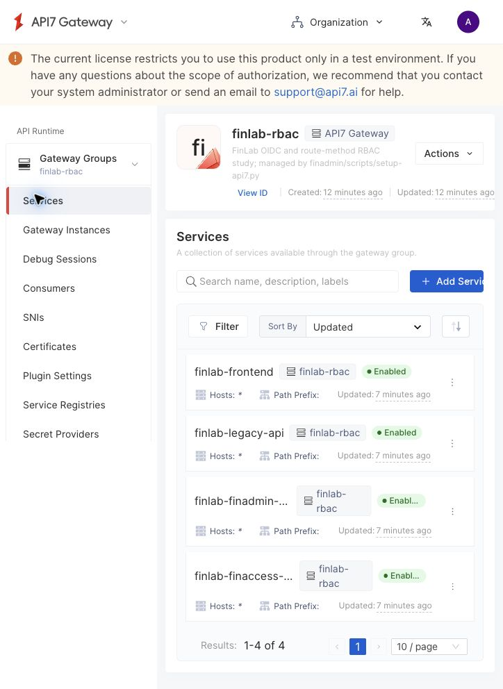
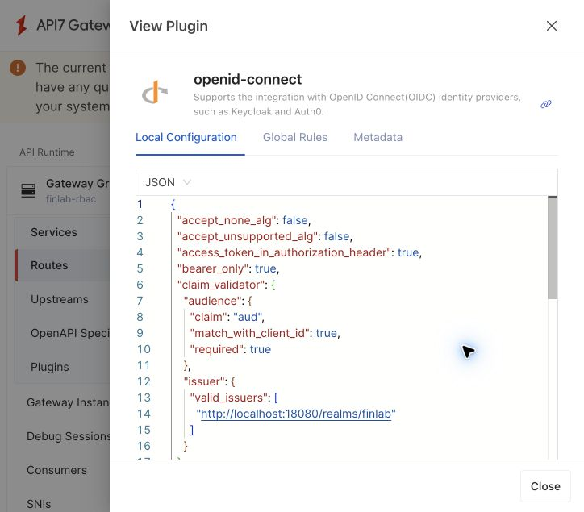
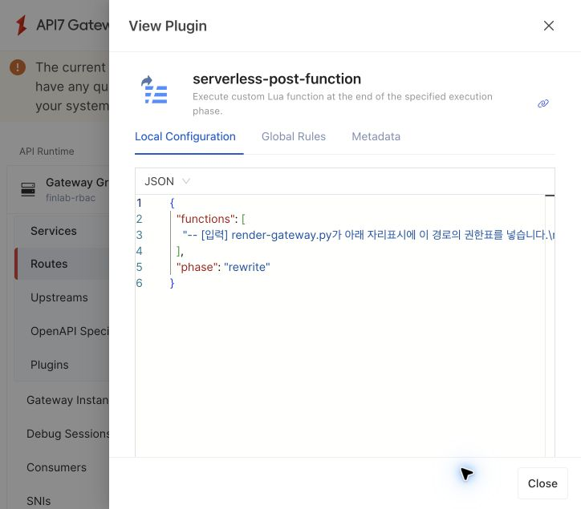

# 실제 API7 Enterprise 콘솔 읽는 법

2026-10-06, 실행 중인 API7 Enterprise 3.10.2의 실제 화면을 캡처했습니다. 아래 순서로 보면 설정이 요청 처리에 어떻게 연결되는지 이해할 수 있습니다. 비밀번호·토큰·라이선스 원문은 포함하지 않습니다.

## 1. 어떤 화면에 들어가야 할까요?

Chrome에서 `https://localhost:7443`을 엽니다. 현재 관리 계정의 최초 비밀번호 변경과 로그인을 완료했습니다. Codex 내장 브라우저의 인증서 오류와 Chrome의 로그인 상태는 별개입니다.

`http://localhost:18091`은 사용자가 로그인하고 API를 시험하는 앱입니다. 설정을 관리하는 제품 콘솔은 7443입니다. API7은 Control Plane에 설정을 저장하고, Gateway 인스턴스가 그 설정으로 실제 요청을 처리합니다.

## 2. Gateway Group과 Service

왼쪽 Gateway Groups에서 `finlab-rbac`를 선택하고 Services를 엽니다.

Gateway Group은 같은 설정을 배포받을 Gateway들을 묶는 단위입니다. 여기에는 FinLab 전용 Gateway를 연결했습니다. Service는 뒤에 연결할 앱과 관련 Route·Upstream 설정을 묶는 대상입니다.

| 실제 Service | 연결되는 대상 | 요청 예 |
|---|---|---|
| finlab-finaccess-api | 금융 업무 Spring 앱 | /access/api/me |
| finlab-finadmin-api | 관리자 Spring 앱 | /admin/api/admin/summary |
| finlab-legacy-api | JWT 검증이 없는 모의 앱 | /legacy/api/reports |
| finlab-frontend | Nginx 정적 사용자 앱 | / |

Enabled는 설정이 활성화됐다는 표시입니다. 실제 요청 성공 여부는 HTTP 검사와 Gateway 로그로 별도로 확인했습니다. 상단 배너는 현재 라이선스가 테스트 환경용이라는 뜻입니다.

## 3. Route에서 인증 설정 찾기

`finlab-finadmin-api`를 열고 Routes의 `/admin, /admin/*`를 선택합니다. Route 상세 아래 Plugins에서 `openid-connect`의 **View**를 누릅니다. 왼쪽 별도 Plugins 메뉴는 Service 범위이므로 혼동하지 마세요. 이번 인증·인가 설정은 Route 범위입니다.

View는 읽기 전용 확인입니다. 여기서는 요청에 실린 Bearer Access Token을 검사합니다. Gateway가 사용자를 로그인 화면으로 보내는 흐름이 아니라, 프런트가 Keycloak에서 받은 토큰을 API 요청에 넣는 흐름입니다.

| 설정 | 쉬운 설명 |
|---|---|
| bearer_only: true | API 요청에 토큰이 있어야 합니다. |
| accept_none_alg: false | 서명 없는 토큰을 허용하지 않습니다. |
| audience.required: true | 이 API를 대상으로 발급됐는지 반드시 검사합니다. |
| match_with_client_id: true | audience가 이 Route의 Client ID와 맞아야 합니다. |
| issuer.valid_issuers | 우리가 신뢰하는 finlab Realm의 발급자인지 검사합니다. |

FinAdmin Route의 대상은 `finadmin-api`입니다. 이 대상 검사를 통과했다고 관리자 권한까지 생기지는 않습니다. 다음 역할 검사도 통과해야 합니다. 전체 생성 설정은 `scripts/setup-api7.py`와 `scripts/render-gateway.py`에서 확인합니다.

## 4. Route에서 역할 검사 찾기

Close로 돌아와 `serverless-post-function`의 View를 누릅니다.

이 플러그인은 Lua 함수를 실행하는 제품 기능입니다. 이번에는 그 안에 경로·HTTP 메서드별 역할 검사 함수를 등록했습니다. 제품의 전용 클릭형 역할 편집기를 사용한 것은 아닙니다. JSON의 긴 함수 문자열은 읽기 어려우므로, 설명과 수정은 주석이 있는 `infra/gateway/rbac.lua` 및 `policies.json`을 함께 봅니다.

예를 들어 `GET /admin/api/admin/summary`라면 `resource_access.finadmin-api.roles`에 `admin`이 있어야 합니다. `user`만 있거나 역할이 없으면 Gateway에서 403으로 끝납니다. 다른 앱의 admin 역할은 대신 사용할 수 없습니다.

실행 순서는 자료형 사전 검사 → OIDC 서명·발급자·대상 검사 → 시간·경로·메서드·역할 검사입니다. `serverless-post-function`의 phase는 rewrite이며, 플러그인 우선순위에 따라 OIDC 이후 실행됩니다. 이름의 post가 백엔드 응답 이후라는 뜻은 아닙니다. 이 Lua 함수의 JWT 해석만으로 서명을 검증할 수 없으므로 OIDC와 반드시 함께 적용합니다.

Route 화면의 Methods에 여러 메서드가 표시되는 것은 Route 매칭 범위입니다. 실제 허용 메서드와 경로는 함수의 정책표에서 더 좁게 제한합니다. 예를 들어 관리자 요약의 POST는 표에 없으므로 거절합니다.

## 5. 통과한 뒤에는 어디로 갈까요?

같은 Service의 Upstreams에서 내부 주소를 확인합니다. FinAdmin은 `finadmin:8081`로 연결됩니다. proxy-rewrite는 `/admin` 접두사를 제거하여 Spring의 `/api/...`로 전달합니다.

Spring에는 원래 Bearer JWT가 전달됩니다. Spring도 서명·발급자·audience와 자신의 역할을 다시 검사합니다. 회사 소속 같은 업무 데이터 규칙은 FinAccess가 판단합니다.

레거시는 다릅니다. Gateway가 역할을 확인한 뒤 외부 신원 헤더를 덮어쓰고, 검증된 sub·iss만 전달합니다. 레거시는 호스트 포트를 공개하지 않고 Gateway만 연결된 내부 네트워크에 있습니다. 따라서 헤더 자체가 암호학적 인증 수단인 것은 아니며, 접근 경로 통제가 신뢰의 전제입니다.

## 6. 화면과 결과를 연결하는 짧은 시연

1. 콘솔에서 위 Service와 Route의 OIDC·역할 플러그인을 보여 줍니다.
2. 별도 18091 사용자 앱에서 일반 사용자로 관리자 요약을 요청합니다. 예상 결과는 Gateway 403입니다.
3. 관리자로 같은 요청을 보냅니다. 예상 결과는 Spring 200입니다.
4. [검증 기록](verification/api7-2026-10-06.json)에서 직접 Spring 호출도 역할을 검사하는 사례를 보여 줍니다.
5. LDAP 그룹 제거 후 기존 토큰은 200, 새 토큰은 403이었던 기록을 비교합니다. 이번 검증 종료 시 그룹은 복원했습니다.

실제 Enterprise 통합 검사 125개가 통과했습니다. 화면에 플러그인이 보이는 사실과 실제 요청이 차단되는 사실을 구분해 설명하세요. [구현 보고서](15-api7-enterprise-integration.md)에 이번 검사 범위와 추가 과제를 적었습니다.

## 자주 헷갈리는 부분

- **API7 로그인 admin과 업무 API의 admin은 같은가요?** 아닙니다. 전자는 설정을 관리하는 운영자, 후자는 Keycloak 토큰에 담긴 앱별 업무 역할입니다.
- **매 요청마다 Keycloak에 로그인하나요?** 아닙니다. API 호출 시 JWT를 검증하며 공개 키 조회·캐시는 로그인과 별도입니다.
- **콘솔에서 수정하면 코드도 바뀌나요?** 아닙니다. 다음 setup 실행은 코드에 정의된 정책으로 관리 대상을 갱신합니다. 실제 정책 변경은 코드와 Spring 규칙을 맞추고 검증 후 반영합니다.
- **새 비밀번호는 어디 있나요?** Git에서 제외한 로컬 관리 자격증명에 반영했습니다. 이 문서와 캡처에는 담지 않았습니다.
