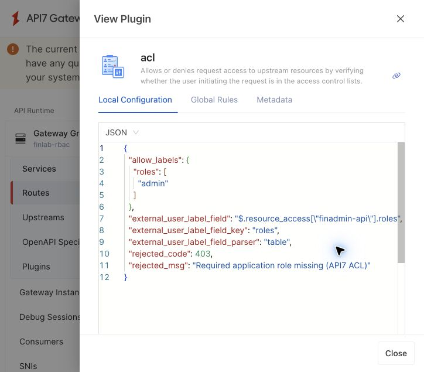

# 인증·인가를 API7 기본 기능으로 모으기

2026-10-06, API7 Enterprise 3.10.2에 적용하고 실제 요청을 확인한 기록입니다.

## 무엇을 바꿨나요?

기존에는 API7의 Lua 함수 안에서 경로·HTTP 메서드와 허용 역할을 비교했습니다. 현재는 **Route가 요청을 선택하고, OIDC가 토큰을 검증하고, 기본 ACL이 역할을 판단**합니다. 같은 정책 원본으로 설정을 만들며 별도 인가 서비스나 Spring 코드는 추가하지 않았습니다.

| 항목 | 현재 API7에서 맡는 기능 |
|---|---|
| 인증 | OIDC: Keycloak 서명·발급자·audience 검증, Bearer 토큰 필수 |
| 허용 경로·메서드 | API별 Route와 원래 URI 조건 |
| 앱별 역할 인가 | 기본 ACL의 allow_labels.roles |
| 역할 없음·다른 앱 역할 | 기본 ACL에서 403 |
| 미등록 경로·메서드 | 낮은 우선순위 fallback의 기본 abort 응답으로 403 |
| 비정상 JWT·시간·역할 자료형 | 짧은 보조 함수로 엄격히 거절 |
| 레거시 신원 전달 | 외부 신원 헤더를 제거하고 검증된 sub·iss만 전달 |
| 요청 전달 | proxy-rewrite와 Service의 Upstream |

등록 수는 Service 4개, Route 18개입니다. 허용 API Route 14개에 각각 ACL이 있으며 fallback 3개와 정적 프런트 1개에는 허용 ACL을 붙이지 않습니다. fallback은 인증 이후 무조건 거절합니다.

## 실제 화면에서 읽는 예

Gateway Groups → finlab-rbac → Services → finlab-finadmin-api → Routes → GET /admin/api/admin/summary → Plugins → acl → View로 들어갑니다.



```json
{
  "external_user_label_field": "$.resource_access[\"finadmin-api\"].roles",
  "external_user_label_field_key": "roles",
  "external_user_label_field_parser": "table",
  "allow_labels": {"roles": ["admin"]},
  "rejected_code": 403
}
```

위 설정은 OIDC가 검증한 사용자의 FinAdmin 역할 배열에서 admin을 찾습니다. 앞선 인증 검사를 통과하지 못하면 ACL만으로 접근을 허용하지 않습니다. 외부 X-Userinfo 헤더나 다른 Access Token 헤더를 붙여도 권한을 올릴 수 없음을 실제 요청으로 확인했습니다.

## 가볍게 유지한 방법

- 정책은 `infra/gateway/policies.json`에만 작성하고 API7 설정은 `scripts/setup-api7.py`로 등록합니다.
- Enterprise에서 실행하는 보조 함수는 `enterprise-identity.lua` 43줄입니다. 이전 79줄 RBAC 함수의 경로 탐색·역할 비교·JWT 재해석을 이 구성에서 제거했습니다. 사전 자료형 검사 함수는 별도로 유지합니다.
- 기존 OSS 컨테이너·설정·RBAC 함수·생성기·OSS 전용 격리 검사 코드를 제거했습니다. Enterprise 설정은 정책표에서 직접 만듭니다. 이전 소스와 실행 기록은 Git 이력으로 남아 있습니다.
- Spring의 기존 JWT·역할 검사는 그대로입니다. 인증 기능 없는 레거시 때문에 모든 백엔드의 검증을 제거하지 않습니다.

회사 소속 확인, 요청자와 승인자가 같은지, 잔액과 이체 상태 같은 규칙은 업무 DB가 필요하므로 FinAccess에 남깁니다. Keycloak은 사용자·Client Role과 토큰 발급을 담당하고, LDAP 그룹 원본도 유지합니다.

이번에 추가하지 않은 것은 별도 인가 서버 호출, 사용자별 API7 Consumer 복제, 사용하지 않는 API Key/Basic/HMAC 인증 체계입니다. 현재 OIDC 요청 흐름에 불필요한 계정·비밀값·네트워크 의존성을 만들지 않았습니다. API7 콘솔 운영자 권한은 API 호출자의 업무 역할과 별개이며 기존 관리 계정 권한은 변경하지 않았습니다.

## 검증 결과

[단일 Enterprise 환경 최종 157개 검사](verification/api7-only-2026-10-06.json)가 모두 통과했습니다.

- 토큰 없음·변조·만료·미래 nbf·대상 불일치, 경로/역할/메서드, 원래 URI 우회.
- 직접 Spring 재검증, 다른 회사 접근, 레거시 격리, LDAP 그룹 변경과 복원.
- 배포된 18개 Route 조회, 정상 query 요청, 위조 신원 헤더, 기본 ACL 거절 응답과 upstream 미도달 로그.

앞서 별도 실행한 [23개 집중 검사](verification/api7-native-acl-focused-2026-10-06.json)는 중간 검증 기록이며 157개에 중복 합산하지 않습니다. 최종 검사에는 해당 검사를 통합했습니다. LDAP 관리자 그룹도 복원했습니다. 일반 사용자의 고유 계좌 생성 요청이 ACL에서 403으로 끝나고 Gateway 로그의 upstream 상태가 `-`인 것을 확인했으며, 계좌는 생성하지 않았습니다.

동일 서명 키의 잘못된 issuer를 Enterprise에서 독립적으로 시험하는 검사는 여전히 추가 과제입니다. 과거 OSS 격리 검사 결과를 Enterprise 결과로 합산하지 않습니다. 운영 TLS·LDAPS·가용성·토큰 즉시 폐기 역시 이번 기본 ACL 전환의 완료 범위에 포함하지 않습니다.

## 다음에 역할을 바꿀 때

정책 JSON과 Spring의 대응 역할 규칙을 수정하고 보안 검사를 수행한 뒤 아래 명령을 실행합니다.

```sh
python3 scripts/setup-api7.py --apply
python3 scripts/verify-gateway-rbac.py
```

setup은 이전 실행의 관리 Route 목록을 로컬에 저장하여 더 이상 쓰지 않는 관리 Route를 정리합니다. 다른 운영자가 만든 Route는 삭제하지 않습니다. 콘솔에서 직접 바꾼 코드 관리 대상은 다음 setup에서 코드 값으로 돌아갑니다. 제품 API를 통한 여러 Route의 업데이트는 하나의 원자적 배포가 아니므로 운영에서는 별도 배포·롤백 절차가 필요합니다.

근거: 설치된 3.10.2 제품의 실제 동작, 저장소 설정·검증 기록, [API7 ACL 설정 문서](https://docs.api7.ai/hub/acl/configuration), [OIDC 설정 문서](https://docs.api7.ai/hub/openid-connect/configuration).
