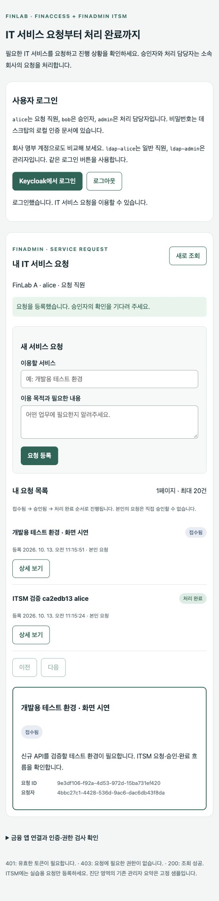
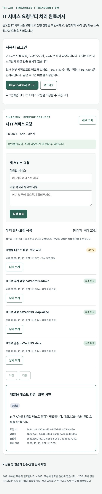
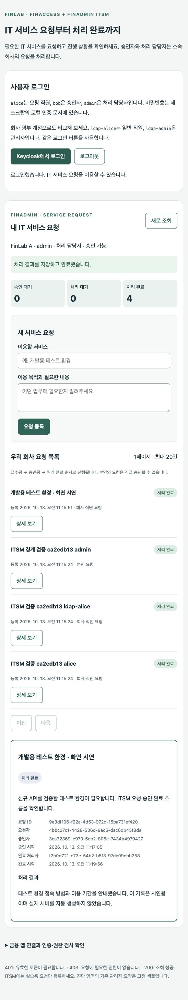

> **과거 학습 기록 — 현재 실행 가이드가 아닙니다.**
> 현재 OAuth2 최소 구성은 [문서 목차](README.md)에서 확인합니다. 이 문서의 금융·ITSM·DB·이전 인증 설정, 주소, 역할 이름과 캡처는 작성 당시의 자료입니다.
> 본문의 “현재”·“최신”도 당시 시점을 뜻합니다. 과거 검사 개수를 이번 검증으로 합산하지 않습니다. 현재 실행 코드는 두 저장소의 `oauth-lab/`이며 USER·ADMIN API 모두 API7을 경유합니다.

# [과거 기록] FinAdmin을 ITSM 서비스 요청 앱으로 발전시키기

작성·검증: **2026-10-13**, 로컬 FinLab. 실제 구현과 실행 결과를 설명합니다.

## 1. 앱 두 개는 어떤 차이가 있나요?

| 앱 | 업무 | 자기 DB에 저장하는 것 |
|---|---|---|
| FinAccess | 회사 계좌와 모의 이체 | 회사·업무 사용자·계좌·이체 |
| FinAdmin ITSM | 직원의 IT 서비스 이용 요청과 처리 | 회사·업무 사용자·요청·승인/완료 기록 |

FinAdmin은 **다른 업무를 맡은 두 번째 앱**입니다. 모든 앱의 권한을 총괄하는 서버가 아닙니다. Keycloak은 로그인과 역할을, API7은 API 경로별 접근을, 각 앱은 자기 업무 데이터와 규칙을 담당합니다.

이번에는 ITSM 중 **서비스 요청 관리** 한 가지를 구현했습니다. 예를 들면 “개발용 테스트 환경을 이용하고 싶습니다”라는 요청을 받고 승인과 처리 결과를 기록합니다. 장애 관리·변경 관리·CMDB·SLA를 포함한 완성형 ITSM 제품은 아닙니다.

저장소·실행 앱·Keycloak Client 이름 `finadmin`, `finadmin-api`와 외부 경로 `/admin`은 유지합니다. 이름을 전부 바꾸는 작업 없이 기존 인증 구성을 재사용합니다.

## 2. 처음 따라 할 업무 흐름

```text
alice: 서비스 이용 요청
  → REQUESTED (접수됨)
bob: 내용을 확인하고 승인
  → APPROVED (승인됨)
admin: 실제로 수행한 작업을 적고 완료
  → COMPLETED (처리 완료)
```

요청이 승인되었다고 작업까지 끝난 것은 아닙니다. 승인자는 “이 요청을 진행해도 되는가”를 결정하고, 처리 담당자는 “무엇을 처리했는가”를 기록합니다. 이번 앱이 서버·계정·라이선스를 자동 발급하지는 않습니다.

| 역할 | 실제 계정 예 | 허용 작업 | 조회 범위 |
|---|---|---|---|
| `user` | alice, ldap-alice | 요청 등록·조회 | 본인의 요청 |
| `approver` | bob, ldap-bob | 요청 등록·조회·승인 | 자기 회사 요청 |
| `admin` | admin, ldap-admin | 요청 등록·조회·승인·완료·현황 | 자기 회사 요청 |

역할은 `resource_access.finadmin-api.roles`에서 읽습니다. `finaccess-api`의 같은 이름 역할이 ITSM 권한으로 자동 인정되지는 않습니다. bob은 편의상 user와 approver를 함께 가지며, admin은 admin 역할로 승인도 할 수 있습니다.

**admin도 자기 요청은 승인할 수 없고 다른 회사 요청에도 접근할 수 없습니다.** 다른 승인자가 승인했다면 요청자가 admin인 경우 자신이 완료 결과를 기록하는 것은 허용합니다. 승인자와 완료 담당자를 반드시 다른 사람으로 강제하는 규칙은 이번에 추가하지 않았습니다.

## 3. 회사와 직원은 어떻게 구별하나요?

요청 JSON에 사용자가 회사나 요청자를 적어 보내게 하지 않습니다.

1. Spring이 JWT의 서명·발급자·대상·시간을 검증합니다.
2. 검증된 `iss`와 `sub`를 읽습니다. `iss`는 신원을 발급한 곳이고 `sub`는 그곳에서 사용자를 구별하는 값입니다.
3. `itsm_users`에서 같은 `identity_issuer + identity_subject`를 찾습니다.
4. 찾은 직원의 `company_id`와 `id`를 요청의 회사·요청자로 저장합니다.
5. 조회·승인·완료 때도 로그인 직원의 회사와 요청의 회사를 대조합니다.

로그인에 성공했어도 ITSM 업무 직원으로 연결되지 않았으면 403입니다. LDAP 계정과 역할이 있다는 사실만으로 회사 소속이 결정되지는 않습니다.

`infra/itsm/demo-users.json`에는 최초 실습용 회사 배치만 있습니다. `scripts/setup-itsm.py`가 실제 Keycloak의 사용자 ID를 조회해 DB에 연결합니다. 런타임 Java 코드는 “이름이 alice면 A회사” 같은 분기를 사용하지 않습니다. 회사 이동·입퇴사 온보딩 UI는 추후 과제이며, 초기 스크립트는 기존 회사 연결이 다르면 자동 덮어쓰기 대신 중단합니다.

| 실습 회사 | ITSM 직원 |
|---|---|
| FinLab A | alice, bob, admin, ldap-alice, ldap-bob, ldap-admin |
| FinLab B | outsider, ldap-outsider |

B회사 승인자·처리 담당자는 아직 준비하지 않았습니다. B회사 직원은 자기 요청을 등록·조회할 수 있고 A회사의 admin은 이를 처리할 수 없습니다.

## 4. API7과 Spring은 무엇을 각각 검사하나요?

| 검사 | API7 Enterprise | FinAdmin Spring |
|---|---|---|
| JWT 서명·발급자·대상·시간 | 검사 | 독립적으로 재검사 |
| 경로·HTTP 메서드별 역할 | 기본 Route + OIDC + ACL | SecurityFilterChain |
| 어느 회사 직원인가 | 업무 DB를 조회하지 않음 | 검증된 신원을 ITSM DB에 연결 |
| 일반 직원의 본인 요청 범위 | 판단하지 않음 | 조회 시 검사 |
| 자기 승인 금지·상태 순서 | 판단하지 않음 | Service와 Entity에서 검사 |

현재 API7 설정은 **Service 3개, Route 22개**입니다. 허용 API 19개에 fallback 2개와 프런트 1개를 더한 수입니다. 이번 ITSM 확장으로 허용 API 7개가 늘었습니다. 별도 인가 서버나 새로운 Gateway를 추가하지 않았습니다.

| 메서드 | Gateway 경로 | 허용 역할 |
|---|---|---|
| GET | `/admin/api/itsm/me` | user / approver / admin |
| GET | `/admin/api/itsm/requests` | user / approver / admin |
| POST | `/admin/api/itsm/requests` | user / approver / admin |
| GET | `/admin/api/itsm/requests/{id}` | user / approver / admin |
| POST | `/admin/api/itsm/requests/{id}/approve` | approver / admin |
| POST | `/admin/api/itsm/requests/{id}/complete` | admin |
| GET | `/admin/api/itsm/summary` | admin |

여러 역할은 OR입니다. API7은 `/admin`을 떼고 같은 Bearer 토큰을 전달합니다. Spring 직접 호출은 `http://localhost:18083/api/itsm/...`입니다. [전체 정책표](14-gateway-rbac-policy.md).

API7 실제 관리 UI에서는 **Gateway Groups → finlab-rbac → Services → finlab-finadmin-api → Routes**로 들어갑니다. `finlab-finadmin-post-api-itsm-requests-id-approve` Route의 Plugins → acl에는 approver·admin, complete Route에는 admin이 허용됩니다. [기존 실제 UI 캡처 가이드](16-api7-console-walkthrough.md)는 메뉴 위치 참고용이며 ITSM 추가 전 화면입니다.

## 5. 코드는 이 순서로 읽으세요

모든 Java 파일의 기준 폴더는 `src/main/java/io/github/greenapple0101/finadmin`입니다.

| 순서 | 파일 | 쉽게 설명하면 |
|---|---|---|
| 1 | [ServiceRequest.java](../src/main/java/io/github/greenapple0101/finadmin/itsm/ServiceRequest.java) | 요청 한 장에 적을 항목과 “접수 → 승인 → 완료” 순서 |
| 2 | [V1 SQL](../src/main/resources/db/migration/V1__create_itsm_requests.sql) | 그 항목을 PostgreSQL의 어떤 표에 저장할지 정한 설계 |
| 3 | [ServiceRequestRepository.java](../src/main/java/io/github/greenapple0101/finadmin/itsm/ServiceRequestRepository.java) | 요청 표에서 필요한 행을 조회하는 창구 |
| 4 | [CurrentItsmUser.java](../src/main/java/io/github/greenapple0101/finadmin/itsm/CurrentItsmUser.java) | 검증된 토큰의 사람을 우리 직원·회사와 연결 |
| 5 | [ServiceRequestService.java](../src/main/java/io/github/greenapple0101/finadmin/itsm/ServiceRequestService.java) | 역할·회사·자기 승인 규칙을 확인하고 상태 변경 |
| 6 | [ServiceRequestController.java](../src/main/java/io/github/greenapple0101/finadmin/itsm/ServiceRequestController.java) | HTTP 요청을 받아 Service에 넘기고 응답 |
| 7 | [SecurityConfiguration.java](../src/main/java/io/github/greenapple0101/finadmin/security/SecurityConfiguration.java) | Controller에 들어오기 전 JWT·역할 검사 |
| 8 | [itsm.js](https://github.com/Greenapple0101/finadmin/blob/a3289b09a0005dbab4799164bd19e39a7144141b/frontend/itsm.js) | 화면의 입력·버튼을 실제 ITSM API와 연결 |

실제 실행 순서는 **Security → Controller → CurrentItsmUser → Service → Repository/Entity → DB**입니다. 읽는 순서는 요청 데이터가 무엇인지부터 이해하기 쉽게 배치했습니다.

`@Transactional`은 승인자·승인 시각·상태를 한 작업으로 저장하게 합니다. 중간에 문제가 생기면 부분 저장하지 않고 되돌립니다. 승인·완료 조회에는 `PESSIMISTIC_WRITE`를 사용합니다. 같은 요청을 동시에 승인하면 먼저 잡은 작업이 끝날 때까지 다른 작업이 기다린 뒤, 바뀐 상태를 보고 409를 받습니다. 서로 다른 요청을 전부 한 줄로 처리하게 만드는 잠금은 아닙니다.

목록은 한 번에 최대 20건을 읽으며 일반 직원은 DB 조회 조건부터 본인 요청으로 제한합니다. 승인자·처리자는 자기 회사 목록을 봅니다. 업무 데이터는 FinAccess DB와 별도인 `itsm-db`·`itsm_data`에 남습니다.

## 6. 화면을 차례로 따라 하기

아래는 **2026-10-13 실제 브라우저에서 요청·승인·완료한 화면**입니다. API7 관리 화면이 아닌 **사용자 업무 앱**입니다. Nginx는 파일만 제공하고 로그인은 Keycloak, 접근 판단은 API7·Spring이 담당합니다.

### ① alice: 요청 등록

[사용자 앱](http://localhost:18090/) → **Keycloak에서 로그인** → alice. 서비스명에 “개발용 테스트 환경”, 사유에 필요한 업무를 적고 **요청 등록**을 누릅니다. `FinLab A · alice · 요청 직원`, **접수됨**, 본인 요청 목록을 확인합니다. 승인 버튼은 없습니다.



### ② bob: 다른 직원의 요청 승인

**로그아웃** → Keycloak의 **Logout** 확인 → 앱에서 다시 로그인 → bob. 요청의 **상세 보기** → **요청 승인**. **승인됨**과 승인자·시각이 남는지 확인합니다. bob에게는 완료 입력란이 없습니다.



로그인 버튼만 다시 눌러 기존 계정의 재인증 화면이 보이면, 계정 옆 **Restart login**으로 사용자 선택을 다시 할 수 있습니다. 발표할 때는 위 로그아웃 순서가 명확합니다.

### ③ admin: 작업 결과 기록

로그아웃 후 admin 로그인 → 승인된 요청의 **상세 보기** → “수행한 작업과 이용 안내” 입력 → **처리 완료로 기록**. 실제 완료 건수와 상세 이력이 함께 바뀝니다. 화면의 UUID는 업무 DB에서 각 요청·직원을 구별하는 ID입니다.



### ④ 권한 차이를 설명하기

“역할이 맞아야 작업 API에 들어갈 수 있고, 그 뒤에도 회사·요청자·현재 상태가 맞아야 실제 처리가 가능합니다. Gateway의 RBAC와 앱의 업무 인가를 함께 적용했습니다.”

LDAP도 `ldap-alice → ldap-bob → ldap-admin`으로 같습니다. approvers 그룹은 FinAdmin의 `user + approver` 역할을 받습니다. 회사 연결은 ITSM DB에서 별도로 유지합니다.

## 7. 실제 확인한 결과

| 검사 | 2026-10-13 결과 | 범위 |
|---|---|---|
| FinAdmin Java 테스트 | **51개 통과** | 기존 JWT 보안 검사, 새 역할 규칙, 실제 PostgreSQL의 업무·회사·동시 승인 검사 |
| 실서비스 자동 검사 | **77개 통과** | 실제 PKCE, API7·직접 Spring, LDAP 사용자, 상태·범위·이력·로그 검사 |
| 브라우저 조작 | 요청 → 승인 → 완료 확인 | alice → bob → admin, 본문 3장 캡처 |
| FinAdmin 재시작 | 완료 이력 유지 | DB 영속 저장 확인 |

77개는 HTTP만 센 수가 아닙니다. 신원·회사·상태·접근 로그 등 assertion도 포함합니다. Java 51개와 합산하지 않습니다. Java 업무 테스트의 일부는 인증 신원을 주입해 업무 규칙에 집중하고, 실서비스 검사는 실제 Keycloak 토큰을 사용합니다. [77건 원본 기록](verification/itsm-2026-10-13.json).

| 상황 | 결과·거절 위치 |
|---|---|
| 토큰 없이 보호 API | API7 401 / 직접 Spring 401 |
| user가 승인, approver가 완료 시도 | API7 기본 ACL 403 / 직접 Spring 403 |
| 다른 회사 조회, admin의 다른 회사 처리 | FinAdmin 403 |
| admin의 자기 승인 | FinAdmin 403 |
| 승인 전 완료, 이미 승인·완료한 작업 반복 | FinAdmin 409 |
| 빈 완료 결과 | FinAdmin 400, 상태는 승인 상태 유지 |
| 일반 직원의 목록 | 자기 요청만 반환 |
| 회사 현황 | `sampleData:false`, 자기 회사의 DB 기록 집계 |

거절 위치는 응답의 `X-Finlab-Backend`·ACL 응답과 **이번 요청의 접근 로그**를 함께 확인했습니다. 역할 부족은 `upstream_status=-`, 회사 거절은 `upstream_status=403`입니다. 단순히 403 숫자가 같다고 같은 위치에서 거절된 것으로 설명하지 않습니다.

과거 10월 6일의 135개 Gateway 검사와 9월 29일의 FinAccess Java 149개를 이번에 다시 실행했다고 주장하지 않습니다. 이번에는 새 ITSM 기능과 기존 FinAccess의 실제 내 정보 호출을 확인했습니다. 서명·만료 등 상세 과거 Gateway 결과는 [날짜 있는 기존 기록](17-api7-native-authorization.md)을 참고합니다.

## 8. 실행·검증·데이터 보존

기존 설치에서는 아래 순서로 반영합니다. API7 라이선스와 로컬 `.local/api7` 등록 정보는 이미 준비된 환경을 전제로 합니다.

```sh
python3 scripts/init-local.py
./gradlew test bootJar
docker compose up -d --build --wait itsm-db finadmin
python3 -c "import sys; sys.path.insert(0, 'scripts'); from verify import wait_ready, ADMIN; wait_ready(ADMIN + '/api/hello')"
python3 scripts/setup-itsm.py
python3 scripts/setup-api7.py --apply
python3 scripts/verify-itsm.py --restart
```

처음 전체 환경을 만들 때는 README의 `./scripts/start.sh`를 사용합니다. ITSM 회사·직원 연결은 LDAP 준비 뒤에 만듭니다. `setup-itsm.py --roles-only`는 LDAP 그룹 매핑 전에 필요한 approver Role을 먼저 준비하는 단계입니다.

검증 스크립트는 **실습 요청 4건을 추가**합니다. 내부·LDAP 요청 2건과 admin 요청 1건은 완료하고, B회사 요청 1건은 접수 상태로 남깁니다. 기존 데이터를 삭제하지 않습니다. `--restart`는 FinAdmin 컨테이너만 재시작합니다. LDAP 그룹은 이 스크립트에서 바꾸지 않습니다.

이번에는 사용자·회사 역할 설정 재실행 시 기존 요청이 남는지도 확인했습니다. DB 비밀번호는 `.env`와 데스크탑의 로컬 인증 문서에만 저장하며 Git에는 올리지 않습니다. 평소 종료는 `docker compose stop`을 사용합니다. `down -v`는 데이터를 지우므로 일상 종료에 쓰지 않습니다.

## 9. 구현 범위와 다음 과제

**완료:** 독립 ITSM 백엔드와 DB, 세 단계 요청 처리, Gateway·Spring RBAC, 회사·본인 요청 범위, 자기 승인 금지, 내부·LDAP 계정 연결, 실제 현황, 이력 저장, 브라우저 업무 화면.

**아직 없음:** 반려·취소·재요청, 첨부·검색·알림, 요청 생성 멱등키, 별도 변경 불가 감사 로그, 회사·직원 관리 UI, 처리자 배정, SLA·CMDB·장애/변경 관리, 실제 자원 자동 발급. 역할·회사 모델은 운영 조직의 결재 체계에 맞춰 더 정해야 합니다.

**운영 전 별도 검증:** TLS·LDAPS, 비밀값 관리, 외부 직접 접근 차단, 백업·복구, 고가용성·부하, 기존 토큰의 권한 회수 정책. 로컬에서 구현한 세 단계 흐름을 운영용 ITSM 구축 완료라고 표현하지 않습니다.

회의에서는 이렇게 설명할 수 있습니다.

> “금융 앱과 별도로 FinAdmin을 IT 서비스 요청 앱으로 확장했습니다. 동일한 Keycloak 신원을 각 앱의 역할과 회사 데이터에 연결하고, API7과 Spring 양쪽에서 접근을 제한했습니다. 직원 요청·다른 사람의 승인·담당자의 완료 기록까지 실제 화면과 API로 확인했습니다.”
