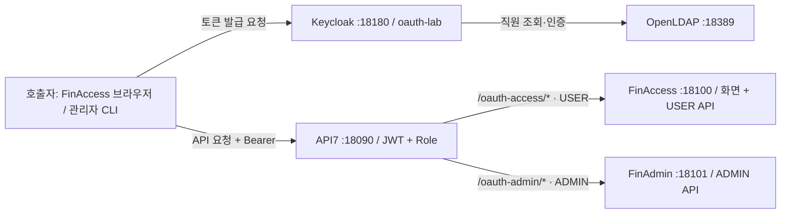
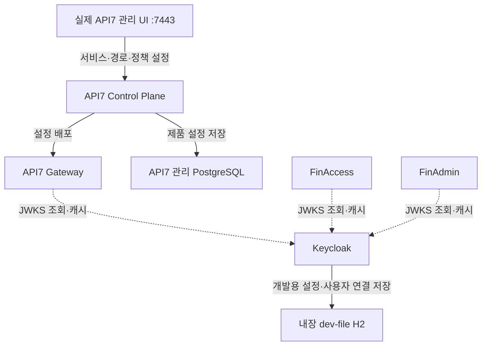
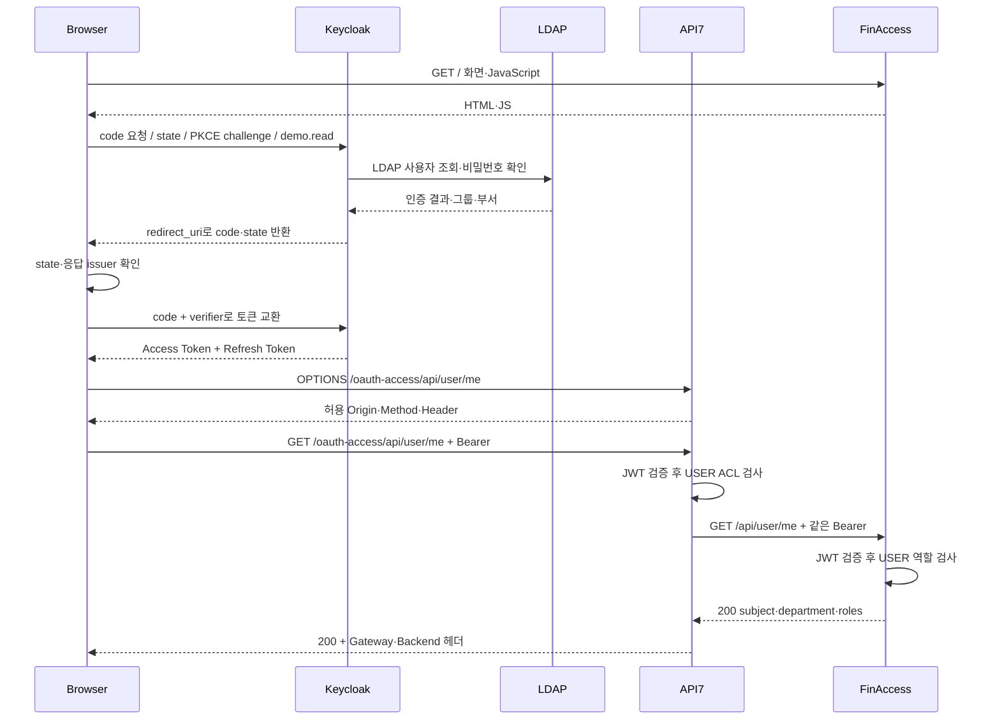
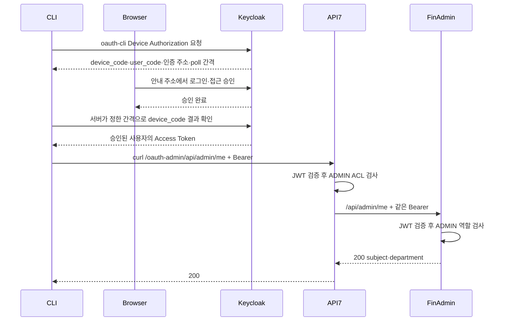

# 현재 아키텍처와 요청 순서

[문서 목차](../README.md) · 기준: 2026-10-15 · 현재 실행 폴더: 두 저장소의 `oauth-lab/`

## API 호출과 로그인

실선은 요청 방향입니다. 토큰·API 응답은 요청자에게 돌아옵니다. Device Grant에서는 CLI가 알려 주는 **Keycloak 기본 화면에서 사람의 로그인·승인**을 합니다. FinAdmin에 별도 로그인 UI를 만들지 않았다는 뜻이지, 비밀번호 확인 없이 토큰을 받는다는 뜻은 아닙니다.

화면은 18100에서 받지만 USER API는 18090으로 보냅니다. Nginx는 현재 최소 구성의 프런트 서버가 아닙니다. 18090의 루트에 남아 있는 이전 화면·경로는 새 실습의 진입점이 아닙니다.

## 키 조회와 관리 설정은 API 요청 경로와 별개

점선 화살표는 공개 키를 요청하는 방향입니다. 공개 키 응답은 반대로 돌아옵니다. API마다 LDAP 비밀번호를 재확인하거나 Keycloak에 로그인 요청을 보내는 구조가 아닙니다. JWKS를 가져오거나 갱신하는 네트워크 요청과, 캐시된 공개 키로 JWT를 검증하는 처리를 구분합니다.

## 실제 주소

| 대상 | 브라우저·호스트 주소 | API7 컨테이너에서 접근 |
|---|---|---|
| FinAccess 화면·USER API | http://localhost:18100 | host.docker.internal:18100 |
| FinAdmin ADMIN API | http://localhost:18101 | host.docker.internal:18101 |
| Keycloak | http://localhost:18180 | host.docker.internal:18180 |
| OpenLDAP | ldap://127.0.0.1:18389 | API7은 LDAP에 직접 로그인하지 않음 |
| API7 API 진입 | http://localhost:18090 | 제품 Gateway |
| API7 실제 관리 UI | https://localhost:7443 | 제품 Control Plane |

`iss`는 `http://localhost:18180/realms/oauth-lab`로 고정합니다. 컨테이너에서 Keycloak에 접속하는 주소가 `host.docker.internal`이라고 해서 토큰의 issuer까지 그 값으로 바꾸지 않습니다. Spring은 호스트의 JWKS URL을 사용합니다.

## USER 로그인과 API 호출

실패하면 해당 단계에서 종료됩니다. 예를 들어 토큰 없음·변조·만료는 401, 유효한 ADMIN 전용 토큰의 USER API 호출은 403입니다. OPTIONS는 CORS가 처리하며 업무 API를 실행하지 않습니다.

## ADMIN 토큰 발급과 curl

CLI 인증에는 ADMIN뿐 아니라 USER도 로그인할 수 있습니다. **Grant가 역할을 부여하는 것은 아닙니다.** 실제 사용자에게 연결된 Role이 토큰에 들어갑니다.

직접 18100·18101로 호출하는 비교 경로도 열려 있습니다. “Gateway 우회 네트워크 차단 완료”라고 설명하지 않습니다. 직접 호출해도 Spring의 검사가 적용되는 것을 확인했습니다.

근거: [프런트 app.js](https://github.com/Greenapple0101/finaccess/blob/main/oauth-lab/src/main/resources/static/app.js), [Device CLI](../../oauth-lab/scripts/device-login.py), [Gateway 설정](../../oauth-lab/gateway), [Keycloak Realm](../../oauth-lab/keycloak/realm.json), [실행 기록](../../oauth-lab/RESULTS-2026-10-15.md).
