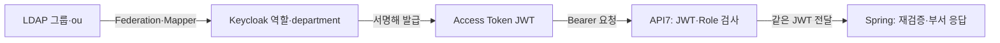

# Keycloak·LDAP 설정과 토큰

[문서 목차](../README.md) · 기준: 2026-10-15 저장소 설정, 10/14·10/15 실행 기록

## Realm·Client·Role

Realm은 이번 실습의 사용자와 설정을 묶는 공간입니다. 현재 Realm은 **oauth-lab**입니다. [realm.json](../../oauth-lab/keycloak/realm.json)에서 아래 값을 확인할 수 있습니다.

| Client | 역할 | 실제 사용 방식 |
|---|---|---|
| oauth-browser | FinAccess 브라우저 | public client, Authorization Code + PKCE S256 |
| oauth-cli | 관리자 CLI | public client, Device Authorization Grant |
| oauth-api | 두 Resource Server의 공통 대상·역할 공간 | bearer-only, USER·ADMIN client role |

위 세 개는 **이 실습 Client**이며 Keycloak 기본 Client까지 포함한 전체 개수가 아닙니다. USER·ADMIN도 업무 Role 두 개를 뜻하며 Keycloak 자체 관리 Role까지 두 개라는 뜻이 아닙니다.

| 설정 | 현재 값 | 이유 |
|---|---|---|
| redirect URI | `http://localhost:18100/` | 로그인 code를 받을 FinAccess 화면 |
| browser web origin | `http://localhost:18100` | 브라우저의 Keycloak 토큰 교환 허용 |
| 요청 scope | `demo.read` | 실습용 scope를 관찰. API 인가는 별도 Role 검사 |
| token audience | `oauth-api` | 두 API가 같은 실습 리소스용 토큰인지 검사 |
| issuer | `http://localhost:18180/realms/oauth-lab` | 신뢰하는 발급자를 고정 |
| Access Token 수명 | 60초 | 실제 만료 401 시연 |
| Implicit·Direct Access Grants | 앱 Client에서 비활성화 | 브라우저 Code+PKCE, CLI Device 사용 |
| ID Token | 현재 요청에서 발급·사용하지 않음 | openid scope를 요청하지 않음 |

Keycloak의 Client protocol, endpoint URL, mapper 이름에 `openid-connect`가 나타납니다. 이것만으로 앱이 ID Token을 소비하는 OIDC 로그인까지 구현했다고 설명하지 않습니다. API7의 같은 이름 플러그인도 현재는 Bearer Access Token 검증 용도입니다.

## JWT에 넣는 값

| Mapper | JWT에 반영하는 내용 | API에서 쓰는 곳 |
|---|---|---|
| api-audience | aud에 oauth-api | Gateway·두 Spring의 대상 검사 |
| api-roles | resource_access.oauth-api.roles | API7 ACL·Spring hasRole |
| subject | sub | 검증된 사용자 식별자 응답 |
| department | 사용자 department 속성 | 부서 정보 응답, 접근 조건으로 쓰지 않음 |

API7과 Spring은 JWT 서명을 먼저 확인한 뒤 역할을 신뢰합니다. **audience는 대상, Role은 작업 권한**입니다. 두 앱이 공통 audience를 받더라도 USER 전용 토큰은 ADMIN API에 접근하지 못합니다. ADMIN은 USER의 상위 Role로 설정하지 않았습니다.

## LDAP 연결

원본: [ldap.json](../../oauth-lab/keycloak/ldap.json), 적용: [configure-auth.py](../../oauth-lab/scripts/configure-auth.py).

| 항목 | 현재 값·의미 |
|---|---|
| Provider | oauth-local-ldap |
| Connection URL | ldap://127.0.0.1:18389 |
| Users DN | ou=people,dc=oauth,dc=lab |
| 조회 Bind DN | cn=keycloak,ou=services,dc=oauth,dc=lab |
| Username / RDN | uid |
| UUID attribute | entryUUID |
| Edit mode / Import users | READ_ONLY / true |
| Cache | NO_CACHE |
| 주기적 전체·변경 동기화 | -1 / -1, 주기 실행 비활성화 |
| TLS | 현재 로컬 실습은 LDAP 평문, StartTLS false |

Keycloak은 조회용 Bind 계정으로 직원을 찾고, 직원의 비밀번호는 LDAP에서 확인합니다. 사용자 정보를 가져오는 설정이 LDAP 비밀번호를 Keycloak 사용자 비밀번호로 복사한다는 뜻은 아닙니다. 조회 계정의 비밀번호는 비공개 로컬 파일에서 주입하며 위 JSON에 실값을 적지 않습니다.

`configure-auth.py`는 사용자·그룹 동기화와 역할 연결을 실행합니다. 사용자/그룹이 실시간으로 모든 시스템에 자동 생성되는 SCIM 시스템은 아닙니다. 이 스크립트를 재실행하면 관리 대상 Client·Provider·Mapper를 파일 기준으로 다시 맞추므로, Keycloak에서 직접 바꾼 실험 설정은 먼저 기록합니다.

## 사용자·그룹·부서

| LDAP 사용자 | LDAP 그룹 → Keycloak 그룹 | oauth-api Role | LDAP ou → JWT department |
|---|---|---|---|
| ldap-user | USER → /ldap/USER | USER | Engineering |
| ldap-admin | ADMIN → /ldap/ADMIN | ADMIN | Operations |

그룹은 `ou=groups,dc=oauth,dc=lab` 아래 groupOfNames의 member로 연결합니다. 부서는 LDAP 사용자의 `ou`를 Keycloak `department`에 연결하며 `always.read.value.from.ldap=true`입니다. 비교용 Keycloak 내부 계정 alice=USER, admin=ADMIN도 남아 있습니다. 그 계정들은 LDAP 계정이 아니므로 같은 부서 값이 있다고 가정하지 않습니다.

## 무엇이 API7까지 전달되는가

10/14에는 ldap-admin의 ou를 Operations → Support로 바꾼 뒤 **새 로그인 토큰은 Support, 기존 미만료 토큰은 Operations**인 것을 확인하고 Operations로 복원했습니다. API7에 직원을 운영자 계정으로 생성한 결과가 아닙니다. 토큰 내용은 발급 후 LDAP가 바뀌어도 저절로 수정되지 않습니다.

현재 최소 구성에서 확인한 것은 **부서 속성 변경**입니다. 기존 JWT 즉시 폐기, SCIM 기반 가입·퇴사 처리, 부서별 인가 정책은 구현하지 않았습니다.

토큰과 Grant의 쉬운 설명: [OAUTH-NOTES](../../oauth-lab/OAUTH-NOTES.md). 실제 변경·복원 명령: [RUNBOOK](../../oauth-lab/RUNBOOK.md).
