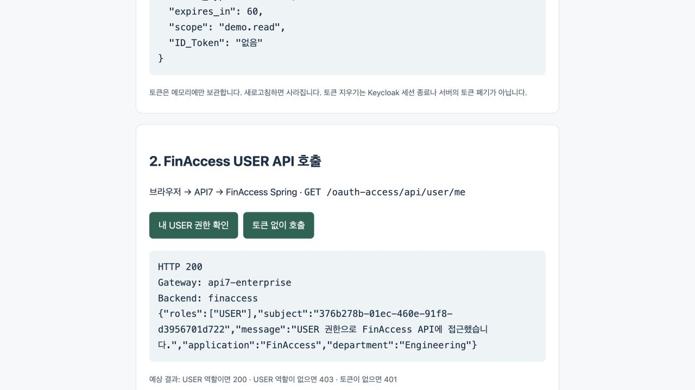
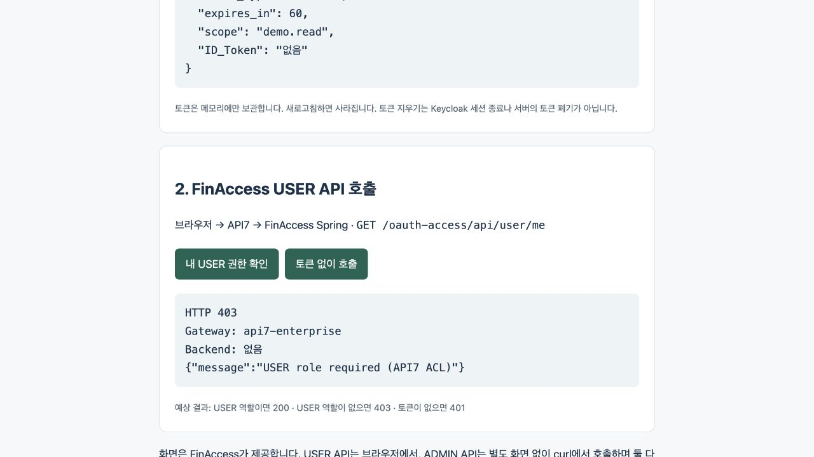

# 검증 결과와 화면 근거

[문서 목차](../README.md) · 문서 정리일: 2026-10-15

## 날짜별 기록

| 기록 | 당시 구성 | 결과와 범위 |
|---|---|---|
| [2026-10-14](../../oauth-lab/RESULTS-2026-10-14.md) | USER는 Spring 직접, ADMIN은 API7 경유 | 수동 HTTP 관찰 23건. LDAP·Device Grant·부서 변경·JWT·200/400/500 등 |
| [2026-10-15](../../oauth-lab/RESULTS-2026-10-15.md) | USER도 API7 연결, 양쪽 모두 Gateway 경유 | 수동 HTTP 관찰 19건. 새 경로·CORS·역할·변조·만료와 ADMIN 회귀 확인 |

두 수를 합쳐 “42개 자동 테스트”라고 표현하지 않습니다. JUnit 테스트를 추가한 작업이 아니며, 이번 **문서 정리 과정에서 위 시나리오를 새로 실행한 것도 아닙니다.** 현재 문서는 코드·설정과 이미 남긴 실행 기록을 대조했습니다.

## 10/15 핵심 결과

| 요청 | 실제 응답 | 확인한 위치 |
|---|---|---|
| USER → USER API | 200 | API7 + FinAccess |
| ADMIN → ADMIN API | 200 | API7 + FinAdmin |
| USER → ADMIN API | 403 | API7에서 차단, 직접 호출은 FinAdmin에서도 차단 |
| ADMIN → USER API | 403 | API7에서 차단, 직접 호출은 FinAccess에서도 차단 |
| 토큰 없음·변조·실제 만료 | 401 | Gateway 및 해당 직접 호출 경로. 세부 범위는 원본 표 참조 |
| USER 경로 허용하지 않은 메서드·경로 | 403 | API7 fallback |
| 허용 Origin의 OPTIONS | 200 + CORS 허용 헤더 | API7만 처리 |
| 다른 Origin의 OPTIONS | 200, 허용 Origin 헤더 없음 | 브라우저 교차 출처 허용은 실패 |

부서 Operations → Support → Operations 복원 및 FinAdmin의 400·500·404는 **10/14 기록**입니다. 10/15에 전부 다시 검증한 것으로 표시하지 않습니다. 서명·issuer·audience 설정 존재와 모든 잘못된 issuer·audience 사례의 신규 실행도 구분합니다.

## 실제 FinAccess 사용자 화면

아래 두 장은 **2026-10-15 사용자 앱 캡처**입니다. API7 관리 UI 캡처가 아닙니다. 비밀번호·Access Token 원문을 노출하지 않고 HTTP 상태와 역할·경유 헤더를 보여 줍니다.

### USER 허용

확인할 부분: HTTP 200, Gateway: api7-enterprise, Backend: finaccess, USER·Engineering. 화면 제공 서버와 API 경유 서버가 다른 것을 보여 줍니다.

### ADMIN 전용 토큰의 USER API 접근 거절

확인할 부분: HTTP 403, Gateway 표시, Backend 없음. ADMIN이 모든 API의 상위 권한이라는 가정을 하지 않았음을 보여 줍니다. 스크린샷 하나만으로 모든 검증을 증명하지 않으며 전체 조건은 날짜별 표를 함께 읽습니다.

## 재현 순서

1. [RUNBOOK](../../oauth-lab/RUNBOOK.md)대로 프로세스·API7을 준비합니다.
2. 브라우저에서 ldap-user 로그인 → USER API 200 → 토큰 없는 요청 401.
3. ldap-admin 로그인 → 같은 USER API 403.
4. CLI Device 로그인으로 ADMIN 토큰을 발급 → FinAdmin 200·400·500.
5. USER 토큰으로 관리자 API 403, 직접 Spring 호출에서도 권한 검사 비교.
6. 복사본 JWT 역할 변조 401과 정상 토큰 실제 만료 401을 별개로 확인합니다.
7. 부서 실험을 했다면 Operations로 복원하고 새 토큰 응답을 확인합니다.

비공개 헤더 파일·계정 정보·export는 Git에 올리지 않습니다. API7 새 Route의 UI 클릭 편집, SCIM, 운영 네트워크 차단·TLS·장애·부하, AI 모델 호출은 완료로 표시하지 않습니다.
