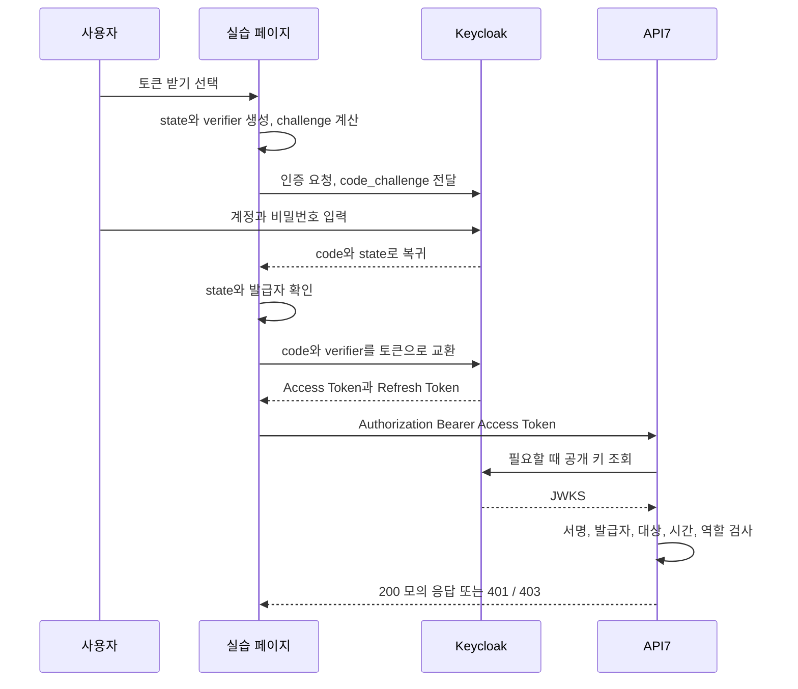

# Keycloak과 API7 OAuth2 실습

목표는 **사용자가 허용한 API 접근 권한을 Access Token으로 전달하고, API7이 토큰과 역할을 검사하는 과정**을 이해하는 것입니다. 업무 앱을 만드는 대신 설정과 HTTP 요청에 집중합니다.

## 1 기획

사용자는 Keycloak에서 본인을 확인한 뒤 실습 페이지로 돌아옵니다. 페이지는 Authorization Code와 PKCE verifier를 토큰으로 교환합니다. API7은 이 Access Token을 검사하고, 허용된 요청에만 간단한 JSON을 반환합니다.

| 포함 | 제외 |
|---|---|
| Authorization Code + PKCE, Access Token, 토큰 갱신 | OIDC 로그인 결과 처리, ID Token, UserInfo |
| Keycloak Client, API audience, 사용자 역할 | LDAP, 회사 구분, 금융 이체, ITSM |
| API7의 토큰 검증, 역할 검사, 모의 응답 | Spring 백엔드, JPA, 업무 DB, 자동화 테스트 코드 |

OAuth2는 API 접근 권한을 다루는 규약입니다. Keycloak 로그인 화면에서 사용자를 확인하지만, 이 실습 페이지는 사용자 로그인 신원을 증명하는 OIDC 기능을 구현하지 않습니다. API 호출 결과를 확인하는 OAuth2 클라이언트입니다.

**제품 이름과 사용하는 기능을 구분합니다.** Keycloak Client type과 API7 플러그인에는 `openid-connect`라는 이름이 남습니다. 요청 scope에는 `openid`를 넣지 않고, ID Token과 UserInfo는 사용하지 않습니다. 플러그인은 `bearer_only` 모드로 Access Token 검증만 담당합니다. Discovery 문서는 공개 키 위치를 찾는 제품 설정에 사용됩니다.

## 2 유즈케이스

| 번호 | 누가 | 하는 일 | 확인할 결과 |
|---|---|---|---|
| UC1 | 일반 사용자 alice 또는 관리자 admin | Keycloak 인증 후 코드 교환 | Access Token 발급, ID Token 없음 |
| UC2 | alice 또는 admin | 일반 API 호출 | 필요한 user 역할이 있으면 200 |
| UC3 | alice 또는 admin | 관리자 API 호출 | alice는 403, admin은 200 |

추가로 토큰을 보내지 않거나 토큰이 만료되면 401인지 확인합니다. 관리자는 user와 admin 역할을 함께 갖습니다. Keycloak 관리 콘솔 운영자와 API의 admin 역할은 별개입니다.

## 3 API와 역할 명세

API7 주소는 `http://localhost:18090`이며 아래 경로는 기존 업무 경로와 겹치지 않습니다.

| 메서드 | 경로 | 토큰 | 필요한 Client Role | 성공 응답 |
|---|---|---|---|---|
| GET | `/oauth-lab/api/read` | 필수 | `oauth-api:user` | 200, `{"message":"read allowed"}` |
| GET | `/oauth-lab/api/admin` | 필수 | `oauth-api:admin` | 200, `{"message":"admin allowed"}` |
| OPTIONS | 위 두 경로 | 불필요 | 없음 | 브라우저 CORS 사전 확인용 204 |

허용된 GET 요청은 API7의 mocking 기능으로 응답합니다. 별도 업무 서버가 없습니다. 토큰 없음·변조·만료는 401, 역할 부족은 403을 기대합니다. 표의 상태 코드는 **예상값**이며 이번 실행 결과는 [실행 기록](RESULTS.md)에서 구분합니다.

Keycloak의 두 엔드포인트는 우리가 개발하지 않습니다.

| 요청 | 핵심 입력 | 반환 |
|---|---|---|
| `GET /realms/oauth-lab/protocol/openid-connect/auth` | client_id, redirect_uri, response_type=code, scope=demo.read, state, code_challenge, code_challenge_method=S256 | 실습 페이지로 code와 state 반환 |
| `POST /realms/oauth-lab/protocol/openid-connect/token` | grant_type=authorization_code, client_id, code, redirect_uri, code_verifier | access_token, token_type, expires_in, refresh_token |
| 같은 token 경로에 POST | grant_type=refresh_token, client_id, refresh_token | 새 Access Token |

`demo.read`는 이 실습이 요청하는 OAuth scope 이름입니다. 관리자 권한을 만들어 주지 않습니다. 이 실습의 경로 인가는 별도로 Keycloak Client Role을 API7 ACL이 검사합니다. scope를 문자열로 요청하는 것과 관리자 역할을 부여받는 것은 다릅니다.

## 4 시퀀스

PKCE는 코드 교환자가 처음 인증을 시작한 클라이언트인지 확인하는 장치입니다. `state`는 돌아온 응답을 우리가 시작한 요청과 연결합니다. JWT 서명 검증은 토큰이 변조되지 않았는지 확인합니다. 서로 다른 단계를 보호합니다.

## 5 파일을 이렇게 나눈 이유

| 위치 | 역할 | 읽는 순서 |
|---|---|---|
| `README.md` | 기획, 유즈케이스, 명세, 시퀀스 | 1 |
| `keycloak/realm.json` | 실습용 Realm, Client, 역할 설정 | 2 |
| `gateway/routes.json` | API7의 두 API와 사전 확인 경로 설정 | 3 |
| `frontend/index.html` | 버튼과 응답 표시 | 4 |
| `frontend/app.js` | 코드 교환과 토큰을 붙인 API 호출 | 5 |
| `scripts/` | 로컬 시작과 설정 적용을 돕는 명령 | 필요할 때 |
| `RUNBOOK.md` | 실제 설정 화면과 실습 순서 | 실습할 때 |

Spring 코드가 필요하지 않아 `src`와 `test`를 만들지 않습니다. 기존 프로젝트는 다른 폴더에 보존합니다. 비밀번호, 실행 파일, H2 DB와 로그는 Git에서 제외한 `.local`에 둡니다.

## 6 실행 환경

Keycloak은 로컬 JDK와 개발용 내장 H2 DB를 사용합니다. 화면 파일은 JDK의 `jwebserver`가 `localhost:18100`에서 제공합니다. 이것은 Gateway 관리 UI가 아닙니다. API7의 실제 관리 콘솔은 `https://localhost:7443`입니다.

API7은 JVM 애플리케이션이 아닙니다. 기존 Docker 설치 또는 지원하는 Linux 설치가 필요합니다. API7 제품 내부의 설정 DB는 업무 DB와 별개이며, 이번에 금융·ITSM DB를 사용하지 않는다고 제품 DB까지 제거하는 것은 아닙니다. 실행 방식은 사용자 선택 후 적용합니다.

이 로컬 HTTP 실습은 운영 배포가 아닙니다. 실습 계정만 사용하고, 화면은 토큰 원문 대신 발급 결과와 응답 코드만 표시합니다. 새로고침하면 메모리의 토큰은 사라집니다.

## 공식 참고 자료

- [OAuth2 RFC 6749](https://www.rfc-editor.org/rfc/rfc6749): Authorization Code와 토큰 발급
- [PKCE RFC 7636](https://www.rfc-editor.org/rfc/rfc7636): 코드 교환 보호
- [Keycloak JVM 실행](https://www.keycloak.org/getting-started/getting-started-zip): 로컬 개발 실행
- [API7 Access Token 검증 설정](https://docs.api7.ai/hub/openid-connect/configuration)
- [API7 ACL](https://docs.api7.ai/hub/acl/configuration)
- [API7 모의 응답](https://docs.api7.ai/hub/mocking/configuration)
